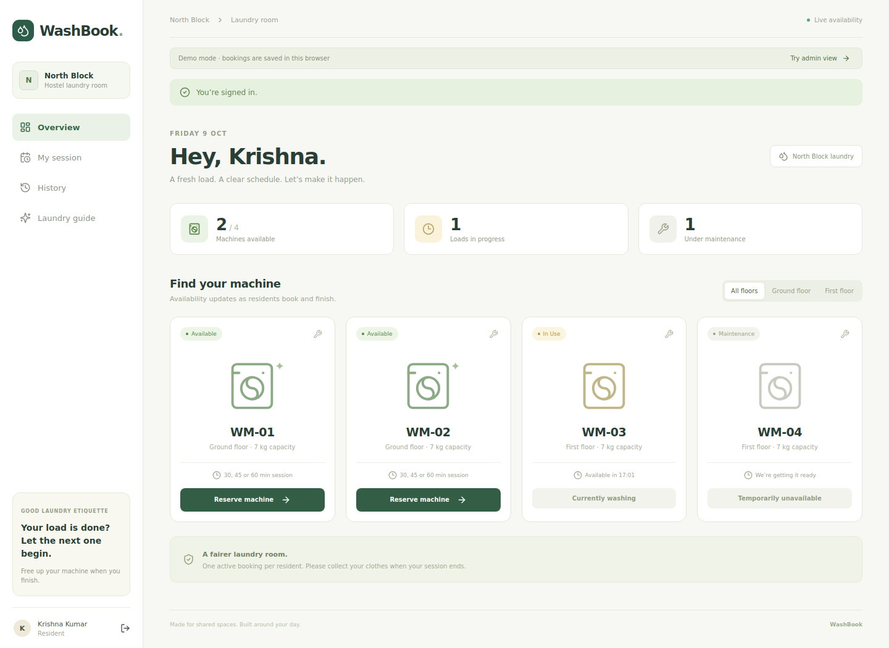
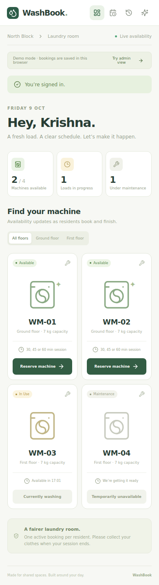

# Validation

Checks performed on 9 October 2026.

- 3 domain tests passed.
- 14 Firestore integration/security-rules tests passed against local Firestore and Auth emulators.
- 2 callable HTTP tests passed, including authenticated booking, extension, completion, and unauthenticated rejection.
- TypeScript and Vite production builds passed, including Firebase mode.
- Desktop and 390px mobile demo walkthroughs passed in headless Chrome, with no page errors.

Callable tests serve the actual exported `onCall` handlers over local TCP using Express and verify emulator-issued tokens through the Admin SDK. The standard Functions emulator's Unix-socket transport could not execute requests in the build workspace. Interactive development still supports the standard Functions emulator.

Live Firebase deployment, Google sign-in, and scheduled execution require your Firebase project and have not been tested against a live project. Vite reports a size warning for the dynamically loaded Firebase SDK chunk in Firebase mode.

